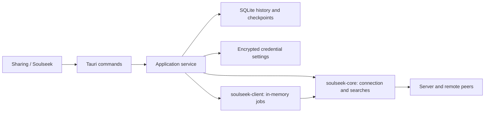

# Soulseek in Sharing

Sharing (`/connect`) has independent **Rau Connect** and **Soulseek** tabs. Soulseek
does not require a Rau device identity. Switching tabs only changes the view;
the Rust application owns connections, searches and transfers.

The connection form defaults to `server.slsknet.org:2242` (host
`server.slsknet.org`, TCP port `2242`), matching Nicotine+'s default. A saved or
active server takes precedence, and the field remains editable for private
servers. An empty server passed to the backend also uses this default.

## Package sources and CI

Rau depends on the private [`rauversion/soulseek-rs`](https://github.com/rauversion/soulseek-rs)
repository, pinned to a full commit in `src-tauri/Cargo.toml` and `Cargo.lock`.
That repository contains both `soulseek-client` and its `soulseek-core` dependency.
A sibling checkout is no longer required to build Rau.

Development builds use Git over SSH. The build account needs read access to the
private repository. `.cargo/config.toml` makes Cargo use Git's SSH authentication.
For local library edits, use a Cargo patch override pointing to a checkout, or
push the library change and update the pinned revision in Rau.

The installer and check workflows load the repository-scoped read-only
`SOULSEEK_DEPLOY_KEY` secret through `.github/actions/private-rust-deps`.
The key grants no push access and no access to the Rekordbox repository.
Source publication excludes the whole `reverse/` directory and build output.
The standalone package CI checks Linux, macOS and Windows without that directory.

```sh
npm run tauri:dev
cargo check -p rau-studio --offline
cargo test -p rau-studio soulseek:: --offline --lib
npx tsc --noEmit
npm run build
node --experimental-strip-types --test tests/soulseek-navigation.test.ts
```

## Boundaries



- `soulseek-core` owns protocol framing, sockets, authentication, search tokens,
  browsing and individual transfers.
- `soulseek-client` owns recursive folder planning, in-memory handles, four
  global transfer slots, one slot per remote user, pause/cancel cleanup and up to
  three attempts per job with bounded exponential backoff. Only transient
  transport errors are retried automatically.
- `src-tauri/src/soulseek/model.rs` defines application-owned serializable values.
  No library `JobId`, search token, live handle or password is written into job
  history.
- `store.rs` owns three additive tables in the existing `aifficator.sqlite3`:
  `soulseek_searches`, `soulseek_results`, and `soulseek_downloads`.
- `partial.rs` checks destination containment, filesystem identity, size, mtime
  and bounded content checkpoints before the application authorizes resume.
- `preferences.rs` stores the chosen download directory independently of account
  credentials and resolves default or explicitly selected destinations.
- `mod.rs` owns session lifecycle, durable admission, fresh runtime jobs and
  mapping manager snapshots into persisted application state. Its mutex
  serializes queue mutations; the library performs transfers independently.
- `SoulseekPanel.tsx` polls saved state every 1.5 seconds. Rust checkpoints jobs
  every second and after control operations. Rendering is bounded; filters can
  access all saved search results and browsed folders.

## Download directory and remote browsing

**Carpeta de descarga → Elegir carpeta** saves an existing, canonical local
directory in the application's settings. It is independent of the remembered
login and survives restarts or removing credentials. New file downloads go to
that directory. Downloading `Music\Artist\Album` creates `Album/` beneath it and
preserves all descendants. Changing this preference does not move or retarget
existing jobs or partial files.

**Guardar como…** and **Elegir otro destino** override the destination for one
download. **Preguntar cada vez** removes the preference and restores the native
destination picker for every download. Existing files are still never replaced.

The remote browser materializes implied parent folders from the peer's complete
catalogue. It shows immediate subfolders and files, file sizes and extensions,
clickable breadcrumbs, an up-one-level control and pagination. Its filter can
jump to any folder or filter the current folder's files. Opening a folder from a
search result lands at that folder with its contents visible.

The active session retains only its latest browsed user's catalogue in memory.
Individual browser downloads resolve their source size and attributes from that
catalogue, rather than accepting file metadata from the UI. Folder downloads
reuse the same catalogue when available. A different session cannot adopt the
old catalogue, and a user whose cached catalogue was replaced must be browsed
again before downloading individual files.

## Searches

The application saves a UUID, server, account, query, creation time and state
before sending a search. The runtime token maps results back to that UUID.
Public results are stored by `(search_id, username, remote_path)` and include
file size, extension, real file attributes, slot availability, speed and queue
length. Private/locked files are not offered as downloadable results.

There are at most eight active searches and 5,000 stored results per search.
Searches stop after 60 seconds or when explicitly stopped. Deleting a search
also deletes its results, while already admitted downloads retain independent
copies of their source metadata. Searches active during shutdown/restart become
`interrupted`; their history remains browsable offline. Starting a new search
requires an explicit connection and query.

## Downloads and complete folders

Each durable download records:

| Data | Purpose |
| --- | --- |
| UUID and optional batch UUID | Stable history identity and folder membership |
| Server and local account | Prevent restoration under another session |
| Remote username and full virtual file path | Exact source, without switching peers |
| Expected size, extension and attributes | Recreate the original file request |
| Destination, local output root and remote folder root | Preserve the chosen mapping and directory guard |
| State, actual local bytes, cumulative attempts, last error and timestamps | UI/history and restart policy |
| Partial checkpoint | Verify ownership before authorizing an existing file |

Complete-folder downloads use `browse` and `FolderPlan`, including descendants:
some peers return only the immediate files from `folder()`. The selected folder's
contents are mapped into the selected destination (or a named subdirectory of
the saved default download directory).
The whole plan is validated and persisted in one SQLite transaction before any
worker is scheduled. Live source and destination indexes prevent duplicate
admission; the runtime queue is limited to 1,024 jobs. Finished runtime jobs are
forgotten after their final snapshot is durable, freeing capacity while keeping
history. Files are created without overwriting existing destinations.

Pause and cancel wait for the writer to stop and preserve partial bytes. Cancel
changes the job state, without deleting the file. An explicit retry constructs a
new runtime job and starts a fresh automatic retry budget; the displayed attempt
count remains cumulative. Removing a terminal history record leaves its files
on disk.

## Restart and partial authorization

1. At startup, persisted `queued`, `running` and `retry_waiting` downloads become
   `interrupted`. Paused and terminal states are retained.
2. The user connects the original server/account and explicitly resumes a job.
   Credentials do not trigger an automatic public connection or downloads.
3. Check the saved destination remains under its canonical output root, without
   symlink components. Rebuild a checked `FolderPlan` request so the library's
   output-root guard survives restoration.
4. If no checkpoint exists, only a missing destination may start with
   `CreateNew`. An existing, unowned file is refused, even when its size matches.
5. A checkpointed partial must be a regular file with the same filesystem
   identity, a compatible length and matching SHA-256 samples of its saved
   prefix/tail (up to 64 KiB each). Paused/failed/cancelled jobs require the saved
   length and mtime. An interrupted job may have appended bytes after the last
   checkpoint; the saved samples are checked at their original offsets.
6. Create a fresh library job with `resume_from(actual_length)`. The library
   checks the offset, the peer's advertised size and subsequent partial identity
   between attempts.

The checkpoint proves bounded local continuity, not cryptographic identity of
the remote content. A remote file changed in place at the same path and size, or
a local mutation outside the sampled ranges during unchecked growth, cannot be
fully authenticated by the protocol/checkpoint. A crash between file creation
and its first checkpoint deliberately leaves an untrusted partial: move that
file or select a new destination before retrying.

Normal application exit pauses active jobs, saves their stopped-writer
checkpoints, shuts down the manager and disconnects the client. A checkpoint or
storage failure pauses writers and surfaces an error. A lost connection requires
explicit reconnection; there is no credential-retaining reconnect loop.

## Credentials and sharing

The optional remembered profile (server, username, exact password) uses the
existing authenticated AES-256-GCM settings store. The local settings key file
retains the existing restricted permissions. Passwords are never returned to
React or written into search/download rows. The UI only receives server,
username and a `password_saved` flag; saved credentials can be removed.

Rau Connect's private shares are not published automatically to Soulseek. This
integration covers discovery and downloads; publishing an upload catalogue
needs a separate, explicit UI policy.

## Verification

Tests cover SQLite restart recovery, atomic folder admission, duplicate source
and destination reservations, bounded/deduplicated search results, deletion,
password whitespace, partial growth/content/identity checks, missing partials,
default destination resolution, album subdirectories, per-download overrides
and symlink rejection. Navigation tests cover implied ancestors, distinct album
names, separator normalization, empty folders and repeated entries. A loopback integration test uses two real protocol
clients to restore an interrupted folder into a fresh manager, resumes an
uncheckpointed append, verifies the preserved output-root guard, rejects a
different account and checks the completed file bytes and durable states. It
also downloads a single browsed file into the preferred root using the peer's
original metadata and rejects a different peer or absent filename.
Public-server acceptance requires user credentials and is separate from these
local deterministic tests.
